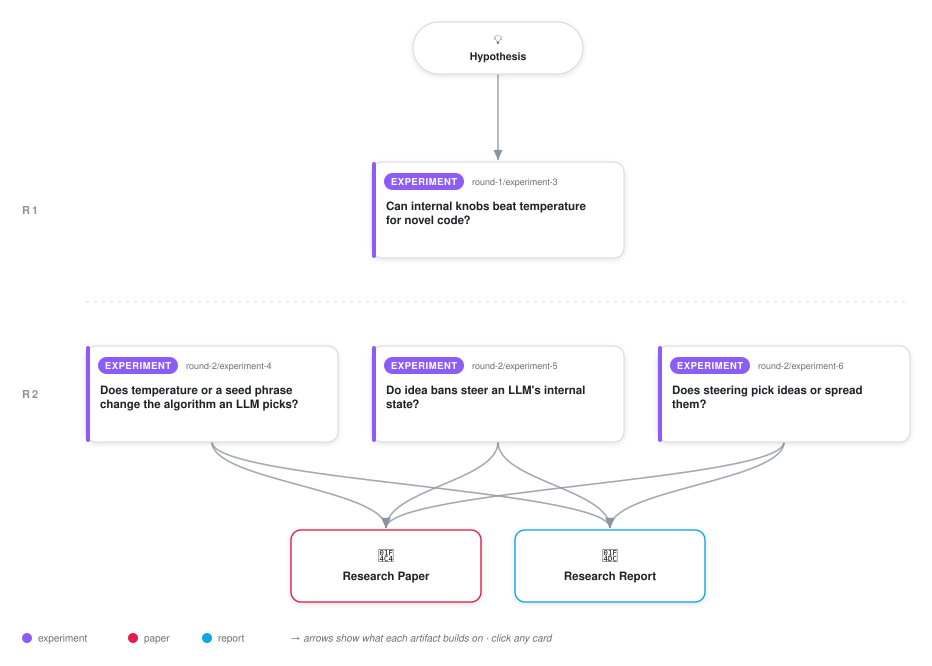

# Steering a 3B Code Model Selects One Known Algorithm Rather Than Diversifying

<div align="center">

<a href="https://cdn.jsdelivr.net/gh/ai-inventor-papers/ai-invention-8d19e3-temperature-flattens-ideas-context@main/workflow.svg">
<picture>
  <source media="(prefers-color-scheme: dark)" srcset="workflow-dark.svg">
  
</picture>
</a>

<sub>🖱️ <b><a href="https://cdn.jsdelivr.net/gh/ai-inventor-papers/ai-invention-8d19e3-temperature-flattens-ideas-context@main/workflow.svg">Open the interactive diagram</a></b> — every card links to its artifact folder.</sub>

</div>

> **TL;DR** — We tested whether a difference-in-means activation-steering direction away from the mode (the default algorithm) of Qwen2.5-3B-Instruct diversifies the algorithms it writes or picks one alternative. The test was preregistered, with rules frozen by hash and checked against five random directions of matched norm. The direction selects. On a redraw of the sorting prompt with fresh seeds, bubble sort fell from 62% of programs to 0%, quicksort rose to 68%, and entropy over algorithm families was 0.73 bits below the random direction mean (95% CI [-0.95, -0.45]). Path search switched from BFS to A* (63%) but its pass rate halved. Steering toward algorithms the model never writes failed where naming them in the prompt succeeded, and every passing program outside the labelled families that a blind judge checked was a known algorithm. The scope is one 3B model with one prompt per task.

<details>
<summary>Full hypothesis</summary>

CLAIM. When an instruction-tuned open-weight model (Qwen2.5-3B-Instruct primary; gemma-2-2b-it as the second family) gets an open design task with the user's BARE prompt (no output contract), the solution idea it implements is drawn from a distribution fixed by a low-dimensional IDEA STATE of the residual stream at the prompt positions: a point in a space where every idea (BFS, DFS, A*, Dijkstra, IDDFS, ...; bubble, quick, merge, counting, ...) has a centroid. Context moves this state; temperature does not. The 'default answer' is therefore the MODE of a multi-modal idea distribution (bare T1: BFS 60%, DFS 15%, A* 13%, Dijkstra 7%), not an average, and context pushes the model into a different region, as in the user's [0,100] -> [80,100] picture. Three consequences are predicted before generation and tested on held-out conditions.

(1) TEMPERATURE FLATTENS, NEVER REORDERS. On the temperature grid that already exists (gen_art_experiment_1/data/raw_grid.jsonl: 3 tasks x T in {0.3,0.5,0.7,1.0,1.3,1.6} x top-k in {10,none} x n=100, 3,623 rows, unlabelled), the log-odds of each idea against the mode are linear in 1/T (Arrhenius R^2>=0.85 for ideas at >=3% at T=1). There are no rank reversals among the top-3 ideas for T<=1.3. Within-idea phrasing diversity rises >=3x faster with T than the number of distinct ideas, which is the user's case (a): a few ideas, each in many phrasings. Top-k=10 caps the number of ideas. Iteration-1 evidence under the contract prompt agrees: going from T=0.7 to 1.0 adds <=0.25 bits of idea entropy, no new class rises above 5%, and correctness then collapses.

(2) A PROMPT BAN IS A DISPLACEMENT OF THE IDEA STATE, NOT A CHOICE-SET RESTRICTION. 'Do not use X' moves the state along X's internal representation. This has three testable consequences.
(2a) Bans violate REGULARITY: unbanned ideas can LOSE share. A random-utility model in which the ban merely removes options cannot produce this. SCREEN evidence comes from the ban arm (gen_art_experiment_2, bare prompt, T=0.7, n=100, labels in data/labels/<T>/<cond>.jsonl), compared with the placebo 'Do not use the Rabin-Karp algorithm.': T2 ban Insertion takes Bubble from 43 to 1; T2 ban Quick takes Bubble from 43 to 15; T2 ban Bubble takes Selection from 8 to 0; T1 ban DFS takes Dijkstra from 11 to 0.
(2b) Whether the freed mass lands on the banned idea's EDGE (its nearest neighbour) or on the FAR SIDE is predictable from the internal geometry, including the sign. The screen shows neighbour attraction in path search: ban BFS takes DFS from 17 to 66; ban Dijkstra takes A* from 1 to 34; banning the rare SPFA primes its neighbour Dijkstra, from 11 to 50; T3 ban Dijkstra takes Bellman-Ford from 0 to 55; banning BFS+DFS+A* gives IDDFS 42, the blend of the banned pair. Sorting instead shows family suppression: banning one quadratic sort depresses the other quadratic sorts, and banning the five comparison sorts gives Counting 45 and Heap 26. The prediction is that a nested model whose substitution weights come only from internals predicts both the destination and the sign (attraction vs suppression) on held-out bans. The internals are (i) idea centroids from baseline and forced-idea runs and (ii) the projection of Delta_h = h(ban) - h(placebo), taken at the prompt positions in the band of layers, onto those centroids. The model must beat IIA renormalisation of the placebo distribution and also an EXTERNAL baseline: a nested logit built on similarities between text embeddings of the algorithm names and descriptions.
(2c) The displacement is CAUSAL. Adding Delta_h_ban to the placebo run's residual at the prompt positions, with no ban text present, reproduces most of the ban's shift in the idea distribution. Subtracting it from the ban run restores the placebo distribution. Matched-norm random displacements do neither.

(3) SEEDS ARE SMALL DISPLACEMENTS. Random context seeds ('seed=d32qxk4nt43', 'seed=(horse chair roof love)') move the idea state by sigma_seed. The flip rate predicted from sigma_seed relative to the utility gap matches the observed flip rate on the existing 360 seed generations (data/raw_seeds.jsonl, unlabelled) and on fresh seed strings. Seeds are inert where the gap is large (T3: 300/300 Dijkstra at baseline).

INFLUENCE. The iteration-1 lead holds: internal directions SELECT rather than flatten. A difference-in-means direction moved T1 from 68% BFS to 145/150 DFS at unchanged pass rate 0.68. That test, however, used a two-idea menu created by the output contract, where 'select' and 'flatten' cannot be told apart. On the bare prompt, with menus of four or more ideas, the claim is that steering lands on the GEOMETRIC NEIGHBOUR predicted by the same centroids that predict ban substitution. The ban displacement Delta_h, used as a text-free steering vector, is then an internal knob that reaches ideas outside the baseline menu (IDDFS, counting sort, Bellman-Ford) at a correct rate several times that of any temperature. In this model, creativity means moving the idea state, not heating the sampler. On these textbook tasks, a correct program that a judge does not recognise is near-floor by construction. The novelty observable is therefore the OFF-MENU CORRECT SHARE together with A*/bidirectional/IDDFS/Bellman-Ford/counting correct counts, not judge-confirmed invention.

EVIDENCE SPLIT (screening discipline). SCREEN, already seen: the ban arm's 4,360 bare-prompt generations (baseline n=300; ban_r1..r4, top3, top5, rare, placebo, para1/2 at n=100; forced_<idea> at n=10; co-mention lists) and the influence arm (art_aSN7z8WuA7Ir, contract prompt). Centroid layer, the lambda/sign rule, the Delta_h projection map and all thresholds are FROZEN on the screen before any confirmation sample exists. CONFIRMATION, never seen: (i) NEW single bans of rank-5..8 ideas never banned so far (T1: greedy best-first, bidirectional, IDDFS, Bellman-Ford; T2: heap, counting, radix, shell), 6 random ban pairs per task, and fresh seed strings; (ii) the reserved task T4 (k-th smallest element) with its own baseline, placebo, forced-idea and ban set; (iii) gemma-2-2b-it on T1/T2, using a subset of these conditions. All are drawn with new sample seeds (1000+), and the placebo is drawn 3 times to give a noise floor. Whatever passes the screen is a candidate until confirmation. If confirmation fails, the claim is dead; there is no subgroup hunting.

PLAN, in priority order (final iteration). A) CPU-cheap behaviour: label raw_grid and raw_seeds, and relabel all ban-arm generations, with ONE shared, audited classifier. Paths use the influence arm's AST classifier; sorts use the ban arm's ideaclf with its 41/41 fixtures plus a 100-program judge audit. Report the agreement between classifiers. Run the sandboxed oracle with code-only extraction on every bare-prompt program. Fit Arrhenius lines; compute Hill-number within/between-idea diversity partitions per (task, T, top-k); check whether the 51% of grid rows truncated at 768 tokens bias the labels at high T; record that vLLM grid bit-reproducibility was 2/20. B) Main GPU bet: capture prompt-position and generated-window residuals for every ban-arm condition plus forced-idea cells extended to n=40 per idea. Build centroids and the user's manifold: PCA/UMAP coloured and sized by implemented count, with before/after-ban arrows, coordinates dumped to results/, and PC1 non-idea variance reported. Fit the predictors on the screen, freeze them, generate the confirmation set, and score held-out JSD, log-likelihood, top-substitute hit rate and sign accuracy. Run the Delta_h transplant and subtraction test against 5 matched-norm random displacements. C) Selector on the bare prompt: difference-in-means away-from-mode on T1/T2 at 2 strengths, and >=5 random draws x n=150 per strength, with entropy compared against the DRAW-AVERAGED random entropy (CI across draws and samples). D) Only if time remains: Gemma Scope SAE latents on gemma-2-2b-it that change between ban and placebo. Does the ban activate the banned idea's latent (priming) and its neighbour's latent?

SUCCESS (CONFIRM if C2 and at least two of the others hold on the confirmation set). C1: the temperature law as stated in (1). C2a: >=3 confirmation single bans lower an unbanned idea's share vs placebo (Holm-corrected Fisher p<0.01, beyond the 3x-placebo noise floor), and the geometry predicts the sign of share change in >=70% of idea x ban cells with |change|>=10 percentage points. C2b: the internal-geometry predictor has >=20% lower JSD than IIA on held-out bans, and its top substitute is correct in >=70% of single bans. Whether it beats the external-embedding predictor is reported either way: a tie reduces the claim to 'substitution follows semantic similarity, read equally well from outside'. C2c: the transplant recovers >=50% of the ban's distribution shift (1 - JSD(patched, ban)/JSD(placebo, ban)), against <=15% for random displacements. C3: predicted seed flip rate within +/-0.10, with <5% flips on T3. C4: ban or Delta_h steering reaches an off-menu correct share >=3x the best temperature's at >=0.8x baseline pass rate.

DISCONFIRMERS, each informative. IIA predicting as well as geometry means bans act as plain restrictions. Random Delta_h being as effective as the real one means non-specific perturbation, the same as iteration 1's random-direction parity. Curved Arrhenius lines or rank reversals mean commitment is gradual, so heat can reorder ideas. Regularity holding on confirmation means the screen violations were draw noise.

</details>

[](https://ai-inventor-papers.github.io/ai-invention-8d19e3-temperature-flattens-ideas-context/) [](https://ai-inventor-papers.github.io/ai-invention-8d19e3-temperature-flattens-ideas-context/interactive.html)

[](https://cdn.jsdelivr.net/gh/ai-inventor-papers/ai-invention-8d19e3-temperature-flattens-ideas-context@main/paper.pdf) [](https://cdn.jsdelivr.net/gh/ai-inventor-papers/ai-invention-8d19e3-temperature-flattens-ideas-context@main/report.pdf) [](https://cdn.jsdelivr.net/gh/ai-inventor-papers/ai-invention-8d19e3-temperature-flattens-ideas-context@main/exec_summary.pdf) [](https://cdn.jsdelivr.net/gh/ai-inventor-papers/ai-invention-8d19e3-temperature-flattens-ideas-context@main/round-2/report.pdf) [](https://github.com/ai-inventor-papers/ai-invention-8d19e3-temperature-flattens-ideas-context/tree/main/paper_latex)

**Round reports:** [Round 1](https://cdn.jsdelivr.net/gh/ai-inventor-papers/ai-invention-8d19e3-temperature-flattens-ideas-context@main/round-1/report.pdf) · [Round 2](https://cdn.jsdelivr.net/gh/ai-inventor-papers/ai-invention-8d19e3-temperature-flattens-ideas-context@main/round-2/report.pdf)

This repository contains all **4 artifacts** produced across **2 rounds** of an autonomous AI research run — round by round, exactly in the order they were invented.

## Round 1

| Artifact | Type | Demo | Source | Builds on |
|----------|------|------|--------|-----------|
| **[Can internal knobs beat temperature for novel code?](https://github.com/ai-inventor-papers/ai-invention-8d19e3-temperature-flattens-ideas-context/tree/main/round-1/experiment-3)** | [](https://github.com/ai-inventor-papers/ai-invention-8d19e3-temperature-flattens-ideas-context/tree/main/round-1/experiment-3) | [](https://colab.research.google.com/github/ai-inventor-papers/ai-invention-8d19e3-temperature-flattens-ideas-context/blob/main/round-1/experiment-3/demo/method_code_demo.ipynb) | [](https://github.com/ai-inventor-papers/ai-invention-8d19e3-temperature-flattens-ideas-context/tree/main/round-1/experiment-3/src) | — |

## Round 2

| Artifact | Type | Demo | Source | Builds on |
|----------|------|------|--------|-----------|
| **[Does temperature or a seed phrase change the algorithm an LL…](https://github.com/ai-inventor-papers/ai-invention-8d19e3-temperature-flattens-ideas-context/tree/main/round-2/experiment-4)** | [](https://github.com/ai-inventor-papers/ai-invention-8d19e3-temperature-flattens-ideas-context/tree/main/round-2/experiment-4) | [](https://colab.research.google.com/github/ai-inventor-papers/ai-invention-8d19e3-temperature-flattens-ideas-context/blob/main/round-2/experiment-4/demo/method_code_demo.ipynb) | [](https://github.com/ai-inventor-papers/ai-invention-8d19e3-temperature-flattens-ideas-context/tree/main/round-2/experiment-4/src) | — |
| **[Do idea bans steer an LLM's internal state?](https://github.com/ai-inventor-papers/ai-invention-8d19e3-temperature-flattens-ideas-context/tree/main/round-2/experiment-5)** | [](https://github.com/ai-inventor-papers/ai-invention-8d19e3-temperature-flattens-ideas-context/tree/main/round-2/experiment-5) | [](https://colab.research.google.com/github/ai-inventor-papers/ai-invention-8d19e3-temperature-flattens-ideas-context/blob/main/round-2/experiment-5/demo/method_code_demo.ipynb) | [](https://github.com/ai-inventor-papers/ai-invention-8d19e3-temperature-flattens-ideas-context/tree/main/round-2/experiment-5/src) | — |
| **[Does steering pick ideas or spread them?](https://github.com/ai-inventor-papers/ai-invention-8d19e3-temperature-flattens-ideas-context/tree/main/round-2/experiment-6)** | [](https://github.com/ai-inventor-papers/ai-invention-8d19e3-temperature-flattens-ideas-context/tree/main/round-2/experiment-6) | [](https://colab.research.google.com/github/ai-inventor-papers/ai-invention-8d19e3-temperature-flattens-ideas-context/blob/main/round-2/experiment-6/demo/method_code_demo.ipynb) | [](https://github.com/ai-inventor-papers/ai-invention-8d19e3-temperature-flattens-ideas-context/tree/main/round-2/experiment-6/src) | — |

## Repository Structure

Artifacts are grouped by the round of invention that produced them. Each
artifact has its own folder with source code and a self-contained demo:

```
.
├── round-1/                         # One folder per round of invention
│   ├── experiment-1/
│   │   ├── README.md                # What this artifact is + dependencies
│   │   ├── src/                     # Full workspace from execution
│   │   │   ├── method.py            # Main implementation
│   │   │   ├── method_out.json      # Full output data
│   │   │   └── ...                  # All execution artifacts
│   │   └── demo/                    # Self-contained demo
│   │       └── method_code_demo.ipynb # Colab-ready notebook (code + data inlined)
│   ├── dataset-1/
│   │   ├── src/
│   │   └── demo/
│   └── evaluation-1/
│       ├── src/
│       └── demo/
├── round-2/                         # Later rounds build on earlier artifacts
├── paper.pdf                        # Research paper
├── paper_latex/                     # LaTeX source files
├── report.pdf                       # Full internal report — every experiment, table and dead end
├── report_latex/                    # LaTeX source of the report
├── exec_summary.pdf                 # Executive summary of the report, at most four pages
├── chat/                            # Every prompt, response and tool call, per module
├── workflow.svg                     # Artifact dependency diagram (this page's header)
└── README.md
```

## Running Notebooks

### Option 1: Google Colab (Recommended)

Click the "Open in Colab" badges above to run notebooks directly in your browser.
No installation required!

### Option 2: Local Jupyter

```bash
# Clone the repo
git clone https://github.com/ai-inventor-papers/ai-invention-8d19e3-temperature-flattens-ideas-context
cd ai-invention-8d19e3-temperature-flattens-ideas-context

# Install dependencies
pip install jupyter

# Run any artifact's demo notebook
jupyter notebook <artifact_folder>/demo/
```

## Source Code

The original source files are in each artifact's `src/` folder.
These files may have external dependencies - use the demo notebooks for a self-contained experience.

---
*Generated by AI Inventor Pipeline - Automated Research Generation*
